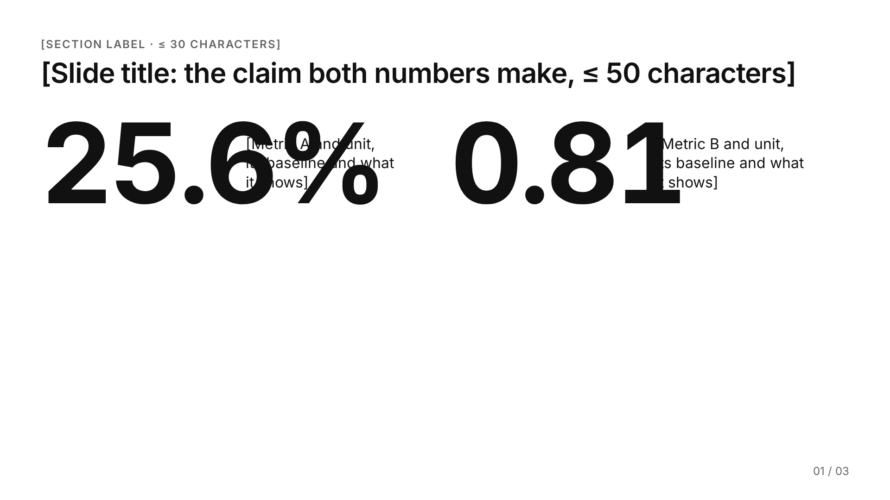
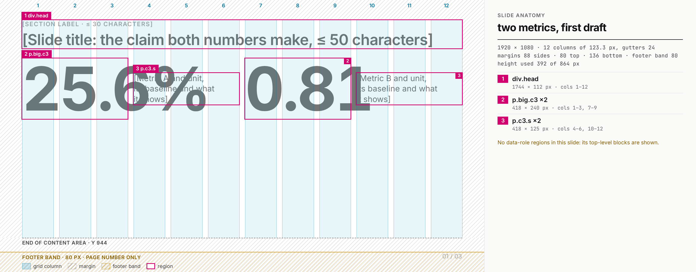
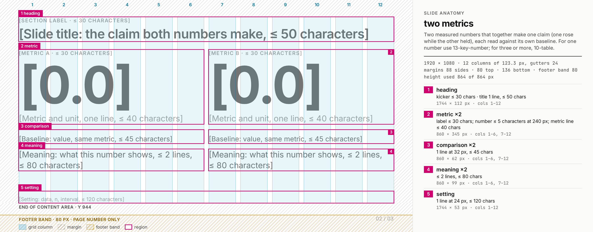
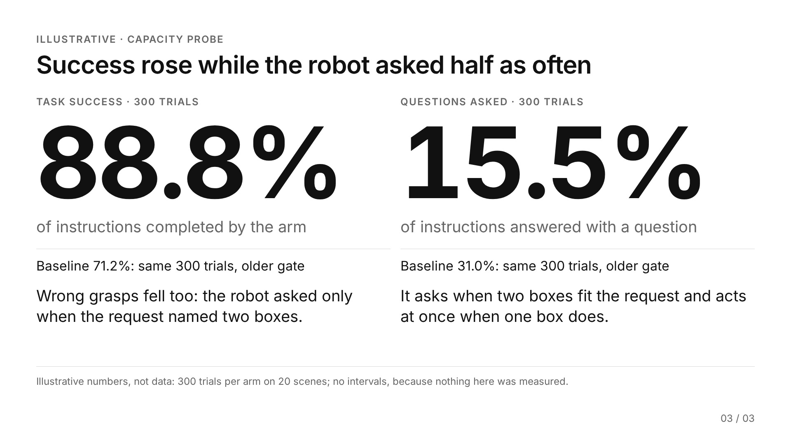

# Template authoring

How the written rules become slide geometry, how to tailor an existing template to new content,
and how to build and accept a new template. A worked example builds a two-metric template from rule
to HTML to checks. The rules come from `slide-rules.md`; the design-system values from
`technical-swiss.md`; the per-template pages from `template-catalog.md`.

`<skill>` is this skill's folder.

## What a template is

A template is one file, `templates/<theme>/slides/NN-name.html`, holding exactly one `<section>`.
It has four parts:

1. **A leading HTML comment** with four keys. `deck.py new` copies the comment into the deck, so the
   limits travel with the slide.
   - `Use:` the job, and when to pick another template;
   - `Grid:` the columns each region takes;
   - `Capacity:` the limit of every slot in lines and characters, and a flow sum that adds up the
     heights against the 864 px content area;
   - `Defaults:` what stays off or stays neutral.
2. **Placeholder text in [brackets]** naming what goes in each slot and its limit, for example
   `[Slide title: the finding, one line, ≤ 50 characters]`.
3. **Region attributes** on each slot: `data-role="<role>"` and `data-cap="<capacity>"`.
   `anatomy.py` reads them to draw and label the regions. They change nothing in the render, and
   `deck.py inline` drops them. (Templates 17 and 18, filled by `explainer.py`, mark slots with
   `data-slot` instead; their anatomy shows top-level blocks.)
4. **Theme classes only**: `.cN`, `.row`, `.stack`, `.head`, `.rule`, `.panel`, the type classes.
   An inline style is allowed for a one-off size or position that the comment explains, for
   example the fixed image sizes, or `margin-top:auto` pinning a line to its box's bottom (the I/O
   lines of 07, the evidence lines of 12). Never an inline colour or a new type size.

`templates/technical-swiss/slides/03-main-content.html` shows all four parts.

## From written rules to geometry

Each rule or spec value becomes a number in `theme.css`, and every template inherits it. The
"basis" column says where each value comes from:

- **source:** the value is stated in a rule or the spec;
- **derived:** computed from other values, with the computation shown;
- **chosen:** a free decision, with the reason given.

| rule or spec value | geometry | basis | lives in |
|---|---|---|---|
| 16:9 widescreen canvas | 1920 × 1080 px; 1 pt = 2 px | derived: a 13.333 in slide is 960 pt wide, and 1920 / 960 = 2 | `section` in theme.css |
| outer margin 0.55–0.65 in | 88 px left and right | derived: 1920 px / 13.333 in = 144 px per inch; 88 px = 0.61 in | `section` padding |
| top and bottom margins | 80 px top, 136 px bottom; cover and section slides 96 / 96 | chosen: the bottom holds the footer band (80 px) plus a 56 px gap above it | `section`, `section.cover` |
| content area | 1744 × 864 px (cover 1744 × 888) | derived: 1920 − 2 × 88; 1080 − 80 − 136 | — |
| 12-column grid, gutter 0.15–0.20 in | 12 columns of 123.33 px, 24 px gutters | derived: 24 px = 0.17 in; (1744 − 11 × 24) / 12 = 123.33 | `.grid12`, `.c1`–`.c12` |
| column spans | `.cN` = N × 123.33 + (N − 1) × 24: c3 418, c4 565, c5 713, c6 860, c7 1007, c8 1155, c9 1302, c12 1744 | derived | `.c1`–`.c12` |
| asymmetric layout; the larger region holds the important visual | splits 4 + 8, 5 + 7, 3 + 9; 6 + 6 only for two equals | source: spec §1, §8 ("Do not give equal visual weight to unequal information") | each template's `Grid:` line |
| type hierarchy in pt ranges | px = pt × 2: main title 80 (40 pt), section 104 (52), slide title 60 (30), statement 72 (36), body 38 (19), secondary 32 (16), caption and table 28 (14), labels 24 (12), equations 48 (24) | source: spec §3 ranges; derived: × 2; chosen: the point inside each range | `--t-*` tokens |
| key number "large enough to be immediately visible" | 240 px (`.big`); 64 px for called-out values (`.num`) | chosen: spec §17 gives no size | `--t-key`, `.num` |
| metadata and footer 10–12 pt | 24 px (12 pt) minimum, except table header labels at 22 px, uppercase | chosen in technical-swiss.md: the top of the spec's range | `deck.py check` (`font`) |
| line length | characters per line ≈ column width ÷ (0.55 × font size) | chosen: 0.55 em is a deliberately wide average; one English sentence measured 17.6 px per character at 38 px against the budget's 20.9, so the budget leaves slack | each `Capacity:` line |
| one meaning per colour | ink, three greys, rule, panel; red = failure, blue = focal, green = meets target, amber = caveat | source: spec §4 | `--red`, `--blue`, … |
| spacing communicates hierarchy | 12 px inside a heading; 20 px from a rule to its text; 24 px gutter and panel padding; 28 px between blocks in a stack; 40 px from the heading to the body | chosen steps; source: spec §23 | `.head`, `.rule`, `.panel`, `.stack`, `section` gap |
| moderate-to-high density, never shrink type | every template has a height budget: the flow sum in its `Capacity:` line must stay ≤ 864 | source: spec §24; rule: split, never shrink | each `Capacity:` line |
| footer: page number only | an 80 px footer band, y 1000–1080, holding only "NN / TOTAL"; content ends at y 944 | source: `slide-rules.md` §5; chosen: 80 px | `--foot-band`, `.foot` |
| R7: a large number beside text gets explicit width with slack, or sits above it | measure the widest value at its size; the column must exceed it | source: `slide-rules.md` §6 | each template with a number |

Line-length budgets for common columns, from the rule above:

| column (px) | 38 px body | 32 px secondary | 28 px caption |
|---|---|---|---|
| c3 (418) | 20 | 23 | 27 |
| c4 (565) | 27 | 32 | 36 |
| c5 (713) | 34 | 40 | 46 |
| c6 (860) | 41 | 48 | 55 |
| c7 (1007) | 48 | 57 | 65 |
| c8 (1155) | 55 | 65 | 75 |
| c12 (1744) | 83 | 99 | 113 |

Subtract a panel's padding (2 × 24 px) before dividing.

Heights for the flow sum:

| element | height |
|---|---|
| heading: kicker + one-line title | 112 px (measured) |
| a 38 px line | 49 px (line-height 1.3) |
| a 32 px line | 42 px |
| a 28 px caption line | 38 px (line-height 1.35) |
| a 24 px label line | 32 px |
| a 240 px number | 240 px (line-height 1) |
| a table row at 28 px | about 47 px |

Measured widths of large numbers are in `verification.md` (worked failure 1).

To see the geometry on any slide, run `python3 <skill>/scripts/anatomy.py --deck <deck>`. It draws
the columns, margins and footer band, and lists each region's size and the columns it spans.

## Tailoring a template to new content

1. **Pick by job**, not by look: `slide-types.md` for the choice, `template-catalog.md` for the
   page with the anatomy.
2. **Read the capacity** in the template's comment or anatomy image before writing.
3. **Write to the capacity.** Count characters for the title and every slot that has a limit.
   - Over the limit: cut words first.
   - Still over: split the slide or switch template.
   - Never lower the type scale or narrow a gutter to make text fit.
4. **Use only the variants the comment names**, for example:
   - 04: 4 + 8 when the text is three short bullets or fewer;
   - 05: one image across `.c8`;
   - 10: the table across `.c12` when it has more than five numeric columns.

   A layout outside those variants is a new template. Build it as below.
5. **Delete unused optional slots** (08's condition, 07's sub-step panel) instead of leaving them
   empty.
6. **Size images to their slot.** Draw charts at the slot's pixel size with `charts.py`
   (`width_px`), so their text stays at 24 px or more.
7. **Check and look.**
   - `deck.py check <deck>`;
   - `deck.py png <deck>`, then look at every slide;
   - `anatomy.py --deck <deck>` when alignment is in doubt;
   - `verification.md` for the whole pipeline.

## Worked example: a two-metric template

The folder `references/templates/authoring-example/` is a small deck with three slides. Its renders
are in `renders/`.

| slide | what it is |
|---|---|
| `01-draft-beside` | the first draft; `deck.py check` rejects it |
| `02-two-metrics` | the accepted template |
| `03-two-metrics-full` | a capacity probe: every slot filled close to its stated maximum |

### 1. The job and the rules that bind it

**The job:** two measured numbers that together make one claim, each read against its own
baseline, for example "Success rose while the robot asked half as often". `13-key-number` holds
one number and `10-table` holds many; nothing holds exactly two.

Rules that bind it:

- **One idea per slide** (`slide-rules.md` §3): the title states the one claim both numbers make.
- **Conditions stay attached** (§2): each number has a metric line (unit and population), a
  comparison on the same metric, and the slide has a setting line (n, data, interval).
- **Colour by meaning only**: both numbers in ink unless red, green or blue applies.
- **R7** (§6): a large number beside text needs measured width with slack, or sits above its text.
- **Type scale and footer band**: no new sizes; nothing below y 944.

### 2. First draft: numbers beside their text

The first idea used four `.c3` columns: number, text, number, text, at the theme's 240 px key
number size.



`deck.py check` rejects it:

```
  slide 01 [text] div.row "25.6% [Metric A and unit, its baseline and wh...": content 1744x265 overflows its 1744x240 box
  slide 01 [collision] p.big.c3 "25.6%" (text): overlaps p.c3.s "[Metric A and unit, its baseline and what it ..." (text) by 301 x 39 px at (530, 332)
  slide 01 [collision] p.big.c3 "0.81" (text): overlaps p.c3.s "[Metric B and unit, its baseline and what it ..." (text) by 63 x 39 px at (1414, 291)
```

The anatomy shows why: each number's box is a 418 px column, and "25.6%" at 240 px is 737 px wide.
It is the R7 incident at template scale. A height estimate passes this draft, since it uses 392 of
864 px.



### 3. Geometry of the accepted layout

| decision | value | basis |
|---|---|---|
| columns | two `.c6` (860 px), cols 1–6 and 7–12 | derived: two equal metrics take the symmetric split |
| number size | `.big`, 240 px | chosen: the theme's key-number size, so no new token is needed |
| number position | above its metric line, never beside text | source: R7 |
| number capacity | ≤ 5 characters | derived from measurement: "25.6%" is 737 px and "−100%" 827 px, inside 860; "100.0%" is 885 px and overflows |
| metric line | `.lead`, 1 line, ≤ 40 characters | derived: 860 / (0.55 × 38) = 41 |
| comparison | `.s` on a hairline rule, 1 line, ≤ 45 characters | derived: 860 / (0.55 × 32) = 48, kept under it |
| meaning | body, ≤ 2 lines, ≤ 80 characters | derived: 2 × 41 = 82 |
| setting | `.meta` on a rule, `margin-top: auto` | source: conditions attached; chosen: pinned to the end of the content area so the two columns end above one shared line |
| height | heading 112 + gap 40 + metric column 562 + gap 40 + setting 53 = 807 of 864; the setting line is pinned to the bottom, so the spare 57 px sits above it | derived: the metric column is 345 + 28 + 62 + 28 + 99 = 562 |

The template file, `slides/02-two-metrics.html`, has the comment with `Use`, `Grid`, `Capacity` and
`Defaults`, a placeholder in every slot, and `data-role`/`data-cap` on the heading, the two metric
blocks, the comparisons, the meanings and the setting line. One metric column:

```html
<div class="c6 stack">
  <div class="head" data-role="metric" data-cap="label ≤ 30 chars; number ≤ 5 characters at 240 px; metric line ≤ 40 chars">
    <p class="kicker">[Metric A · ≤&nbsp;30 characters]</p>
    <p class="big">[0.0]</p>
    <p class="lead">[Metric and unit, one line, ≤&nbsp;40 characters]</p>
  </div>
  <p class="s rule" data-role="comparison" data-cap="1 line at 32 px, ≤ 45 chars">[Baseline: value, same metric, ≤&nbsp;45 characters]</p>
  <p data-role="meaning" data-cap="≤ 2 lines, ≤ 80 chars">[Meaning: what this number shows, ≤&nbsp;2 lines, ≤&nbsp;80 characters]</p>
</div>
```

`deck.py check` reports no problem on it, and its anatomy shows every region on column edges:



### 4. Capacity probe

A template's limits are claims, so test them. `03-two-metrics-full` fills every slot close to its
maximum, with numbers labelled illustrative on the face:

| slot | used of the limit |
|---|---|
| kicker | 29 of 30 characters |
| title | 48 of 50 |
| numbers | 5 of 5 |
| metric lines | 36 and 40 of 40 |
| comparisons | 43 of 45 |
| meanings | 77 and 74 of 80 |
| setting | 113 of 120 |



It passes both checks: `deck.py check` reports no problem on slides 02 and 03, and the PDF check
reports findings on page 1 only (the draft).

### 5. Reproduce it

`deck.py` writes `build/` next to `deck.json`, so work on a copy:

```
cp -r <skill>/references/templates/authoring-example ae
python3 <skill>/scripts/deck.py check ae       # 3 problems, all on slide 01; exit 1
python3 <skill>/scripts/deck.py pdf ae         # findings on page 1 only; exit 1
python3 <skill>/scripts/anatomy.py --deck ae   # ae/build/anatomy/<id>.png and <id>-anatomy.png
```

### 6. Adopting it into the theme

The two-metric template is not yet one of the theme's templates. To adopt it:

1. Copy `slides/02-two-metrics.html` to `templates/technical-swiss/slides/NN-two-metrics.html`, with
   the next free number. Start the comment's first line with that number and the name, as the
   other templates do ("NN two metrics"), and drop the "(worked example …)" note.
2. Run `python3 <skill>/scripts/anatomy.py`. It renders every template again into
   `references/templates/` (clean, anatomy, `gallery.png`). It exits 1 if a `data-cap` number is
   missing from the comment or the placeholder.
3. Add a row to `slide-types.md` and a page to `template-catalog.md`.
4. `deck.py new <deck> --slides two-metrics` now scaffolds it.

## Acceptance checklist for a new template

A new template is accepted when every item holds:

- [ ] **Job:** the `Use:` line names a job no existing template does, and when to pick another one.
- [ ] **Comment complete:** `Use`, `Grid`, `Capacity` (every slot, plus the flow sum ≤ 864, or ≤ 888
      on a cover) and `Defaults`.
- [ ] **Placeholders:** every slot has a bracketed placeholder stating its limit.
- [ ] **Regions:** every slot has `data-role` and `data-cap`; `anatomy.py` prints no warning.
- [ ] **Grid:** in the anatomy, every region sits on column edges, or the comment says why not.
      The pipeline's equal-width nodes are an example of the second case.
- [ ] **Theme only:** theme classes and tokens; no new type size or colour; inline styles only for
      sizes and positions the comment explains.
- [ ] **R7:** any number set at 64 px or more (`.num`, `.big`) is above its text, or its column exceeds the measured
      width of the widest allowed value.
- [ ] **Footer band:** nothing reaches below y 944, or below y 984 on a cover or section slide
      (both stay clear of the band at y 1000).
- [ ] **Placeholder render passes** `deck.py check` and `deck.py pdf`.
- [ ] **Capacity probe passes** both checks with every slot filled to its stated maximum.
- [ ] **Looked at:** the clean render and the anatomy at full size. Check alignment, spacing on the
      12 / 20 / 28 / 40 steps, no expression broken across lines (bind each `≤ N` and each arrow in
      a placeholder with `&nbsp;`, and put a range such as `2–4` in a nowrap span, as the theme's
      templates do), no symbol capitalised by a kicker or header (`.nocase`), and one dominant
      object. One-word last lines fail `deck.py check` (kind `widow`).
- [ ] **Registered:** a row in `slide-types.md`, a page in `template-catalog.md`, and the gallery
      regenerated with `anatomy.py`.
