# Template catalog

One page per technical-swiss template: what it is for, its anatomy, its limits, the rules that bind
it, and one do/don't pair. Templates 01–16 build any deck; 17 and 18 build the two slides per paper
of a paper explainer.

`references/templates/gallery.png` shows all 18 on one sheet (the theme's own
`templates/technical-swiss/gallery.png` shows the 16 general templates). The capacity comment at
the top of each template file (`templates/technical-swiss/slides/NN-name.html`) is authoritative;
the limits below copy it.

Each template has two images in `references/templates/`:

- `<id>.png`: the clean render, with placeholder text;
- `<id>-anatomy.png`: the same slide with the 12 grid columns (tinted, numbered), the margins
  (grey hatching), the end of the content area (dashed line: y 944, or y 984 on cover and section
  slides) and the footer band (amber, y 1000–1080) drawn on it. Every region is outlined and
  numbered, and the legend lists its role, capacity, measured size and columns.

Regenerate both after changing a template: `python3 scripts/anatomy.py`, run from the skill folder.

Rules that bind every template are not repeated per page:

- the heading block (kicker, then a title that states the finding) opens every content slide;
- the kicker and table headers are set in capitals, so a symbol or unit whose case matters (`n`,
  `ms`, `ε`) goes in ``;
- lists are `ul.dash`: an en dash on the column's left edge, the text hanging 1 em in;
- a range or hyphenated term sits in ``, and an arrow or `=` is
  bound with `&nbsp;` (`technical-swiss.md`, typesetting traps);
- the footer is the build's page number, never written into the slide;
- nothing reaches the footer band;
- colour carries one meaning each;
- type never shrinks to fit;
- sources and caveats go in `<aside class="notes">`.

See `slide-rules.md`.

---

## 01 main title

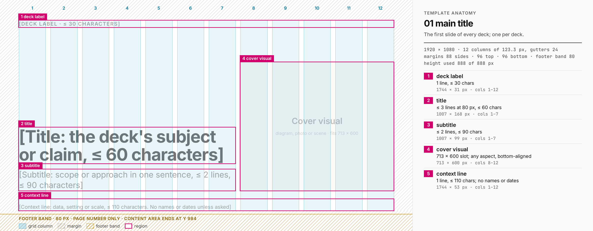

Clean render: `templates/01-main-title.png`

- **Use for:** the first slide of every deck; one per deck.
- **Not for:** section openings (02) or a closing (16).
- **Grid:** title block in cols 1–7, cover visual in cols 8–12 (a 713 × 600 slot, bottom-aligned),
  context line across all 12 columns on a rule. Without a visual, the title block widens to `.c9`.
- **Capacity:**
  - deck label ≤ 30 characters;
  - title ≤ 3 lines at 80 px (≤ 60 characters);
  - subtitle ≤ 2 lines (≤ 90);
  - context line 1 line (≤ 110).
- **Rules that bind it:** no names, affiliations, event names or dates unless asked; no footer
  (`data-nofooter`); the visual stays secondary to the title.
- **Do:** give the scale of the work in the context line ("80 scenes · 1,296 instructions").
  **Don't:** put a logo, an author line or a date there.

## 02 section title

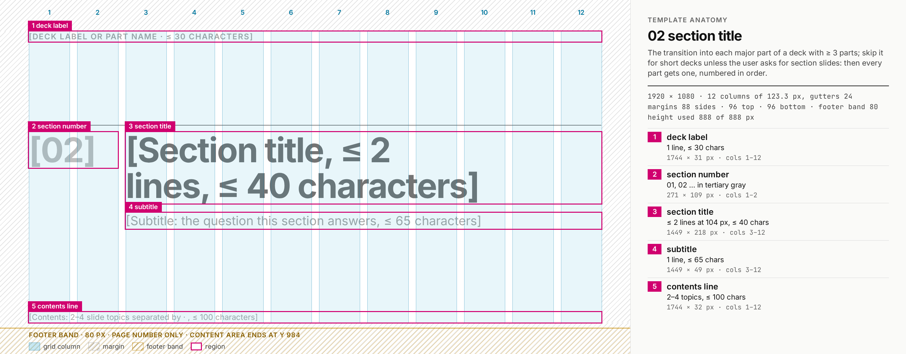

Clean render: `templates/02-section-title.png`

- **Use for:** opening each part of a deck with three or more parts: one per part, numbered 01,
  02, … in order, so no part opens without one, and the kicker numbers match the section numbers.
  They are optional: numbered kickers alone ("02 · Camera sets") can mark the parts instead, as in
  the example deck. All parts or none.
- **Not for:** a two-part deck, unless the user asks; then both parts get one. A one-part deck has
  no section slide (it would only repeat the cover) and no part numbers in its kickers. The paper
  explainer is the exception: `explainer.py` gives every section a divider, one section included,
  because the contents rows link to them.
- **Grid:** section number in cols 1–2, title and subtitle in cols 3–12, on a 2 px rule; a
  contents line at the bottom.
- **Capacity:**
  - title ≤ 2 lines at 104 px (≤ 40 characters);
  - subtitle 1 line (≤ 65);
  - contents line ≤ 100.
- **Rules that bind it:** the number is the section's ordinal in tertiary grey, never an accent; no
  footer.
- **Do:** phrase the subtitle as the question the section answers.
  **Don't:** colour the number to make it "pop": grey is its meaning.

## 03 main content

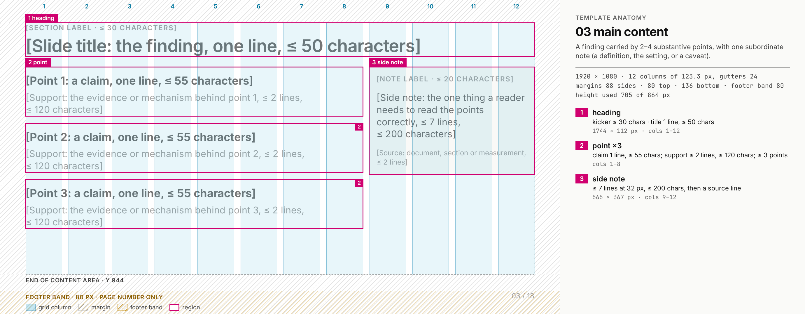

Clean render: `templates/03-main-content.png`

- **Use for:** a finding carried by 2–4 substantive points, with one subordinate note (a definition,
  the setting or a caveat).
- **Not for:** an argument with no single finding (12), or points that are really table rows (10).
- **Grid:** points in cols 1–8, side panel in cols 9–12. For a caveat, swap `.panel` for
  `.rule-amber`.
- **Capacity:**
  - title 1 line (≤ 50 characters);
  - points: ≤ 3, each a one-line claim (≤ 55) with ≤ 2 lines of support (≤ 120), or ≤ 4 points
    with one support line;
  - side note ≤ 7 lines at 32 px (≤ 200).
- **Rules that bind it:** one bold claim per point, nothing else bold.
- **Do:** make each claim a sentence that could stand alone.
  **Don't:** add a fifth point by shortening the support to fragments.

## 04 text + visual

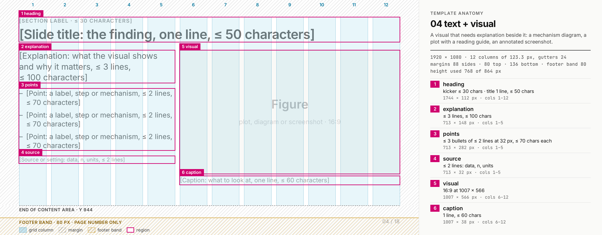

Clean render: `templates/04-text-visual.png`

- **Use for:** a visual that needs explanation beside it: a mechanism diagram, a plot with a reading
  guide, an annotated screenshot.
- **Not for:** a result chart with values to call out (09), or a figure that needs the whole width
  (06).
- **Grid:** text in cols 1–5, visual in cols 6–12 (16:9 at 1007 × 566). Use 4 + 8 when the text is
  three short bullets or fewer.
- **Capacity:**
  - explanation ≤ 3 lines (≤ 100 characters);
  - ≤ 3 bullets of ≤ 2 lines at 32 px (≤ 70 each);
  - source ≤ 2 lines;
  - caption 1 line (≤ 60).
- **Rules that bind it:** text and visual share the top edge; labels sit inside the visual.
- **Do:** draw the visual at 1007 × 566 so its labels stay at 24 px or more.
  **Don't:** shrink the visual to fit a fourth bullet.

## 05 text + images

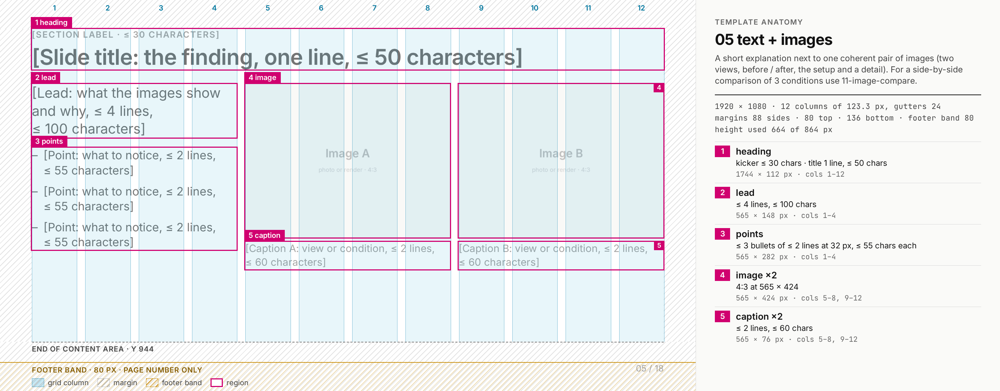

Clean render: `templates/05-text-images.png`

- **Use for:** a short explanation next to one coherent pair of images: two views, before and after,
  the setup and a detail.
- **Not for:** three conditions side by side (11).
- **Grid:** text in cols 1–4; two images of 565 × 424 (4:3) in cols 5–8 and 9–12. One image takes
  the whole `.c8` at 16:9 (1155 × 650).
- **Capacity:**
  - lead ≤ 4 lines (≤ 100 characters);
  - ≤ 3 bullets of ≤ 2 lines at 32 px (≤ 55 each);
  - captions ≤ 2 lines (≤ 60).
- **Rules that bind it:** equal image sizes, edges on the grid, no frames; each caption directly
  under its image.
- **Do:** crop both images to the same aspect before placing them.
  **Don't:** mix a 16:9 and a 4:3 image: their bottoms and captions no longer align.

## 06 full figure

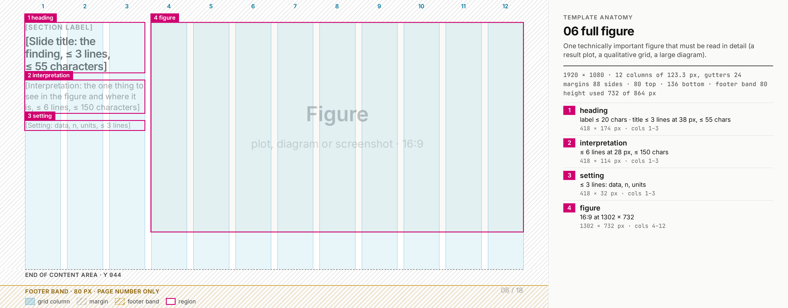

Clean render: `templates/06-full-figure.png`

- **Use for:** one technically important figure read in detail: a result plot, a qualitative grid,
  a large diagram.
- **Not for:** a figure that two sentences explain better (04).
- **Grid:** a compact heading, interpretation and setting in cols 1–3; the figure in cols 4–12
  (16:9 at 1302 × 732). A wider figure (2:1) takes `.c12` under a one-line heading, at most
  1744 × 600.
- **Capacity:**
  - label ≤ 20 characters;
  - title ≤ 3 lines at 38 px (≤ 55);
  - interpretation ≤ 6 lines at 28 px (≤ 150);
  - setting ≤ 3 lines.
- **Rules that bind it:** the title is set at body size so the figure dominates; never shrink the
  figure to make margins.
- **Do:** say where to look in the interpretation ("the red row, bottom left").
  **Don't:** use it for a figure whose own text is under 24 px at this size: redraw it larger, or
  split it.

## 07 pipeline / architecture

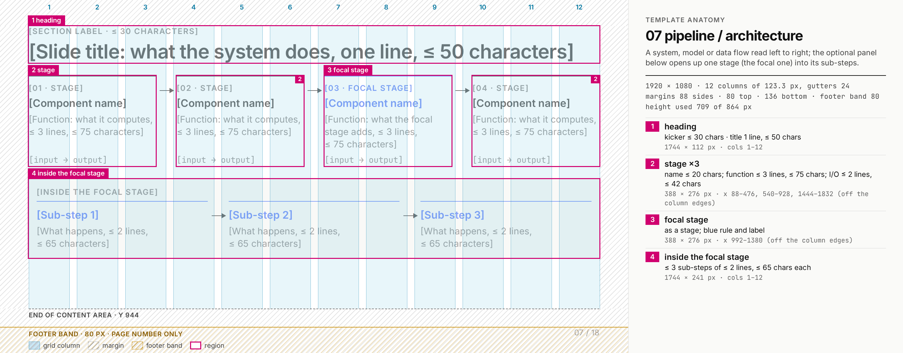

Clean render: `templates/07-pipeline.png`

- **Use for:** a system, model or data flow read left to right. The optional panel opens up the
  focal stage into its sub-steps.
- **Not for:** a process with branches or loops; draw it as a figure (06) instead.
- **Grid:** four nodes of 388 px with 64 px arrow connectors across all 12 columns; five nodes fit at
  about 297 px with shorter text. The nodes divide the width equally, so they align with each other,
  not with the column edges (the anatomy lists their x ranges). Focal stage `.node.blue`, a failing
  or removed stage `.node.red`.
- **Capacity:**
  - per node: a step label, a name ≤ 20 characters (1 line at 32 px), a function ≤ 3 lines at
    28 px (≤ 75), an I/O line ≤ 2 lines in mono at 25 px (≤ 42: 25 characters a line, and words do
    not split), pinned to the node's bottom (`margin-top:auto`) so the I/O lines of all nodes align
    when their functions take different numbers of lines;
  - panel: ≤ 3 sub-steps of ≤ 2 lines at 28 px (≤ 65; some sentences of 69 characters already
    take 3 lines).

  The character counts were measured by rendering sample sentences, not estimated.
- **Rules that bind it:** flat forms, thin arrows, no icons; the main flow reads without the prose.
  The arrows are objects to `deck.py check`, so text that runs under one is a collision. Bind each
  arrow in an I/O line to the word before it (`input&nbsp;→ output`), so no line starts with an
  arrow.
- **Do:** keep I/O lines in mono (`input → output`) so the data shapes line up.
  **Don't:** widen a node's text into the arrow gap.

## 08 equation

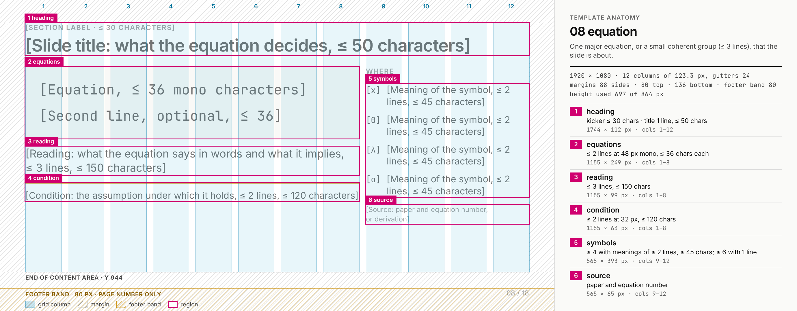

Clean render: `templates/08-equation.png`

- **Use for:** one major equation, or a small coherent group (≤ 3 lines), that the slide is about.
- **Not for:** a derivation of many steps; split it across slides.
- **Grid:** the equation panel, the reading and an amber-ruled condition in cols 1–8; symbol
  definitions in cols 9–12, each symbol in a fixed 56 px slot.
- **Capacity:**
  - equation lines ≤ 2 at 48 px mono, ≤ 36 characters each (3 when the condition is dropped);
  - reading ≤ 3 lines (≤ 150);
  - condition ≤ 2 lines at 32 px (≤ 120);
  - ≤ 4 symbols with meanings of ≤ 2 lines (≤ 45), or ≤ 6 with one line.
- **Rules that bind it:** never below 48 px. Use Unicode mono for simple equations. For stacked
  fractions, roots or accents, write `
TeX
` in place of each
  `
`, which `deck.py` typesets into SVG at build time (it needs matplotlib). The SVG
  is an object to the collision check. The 36-character limit is for mono text only: a TeX line
  must fit the panel's 1059 px inner width, and `deck.py check` reports one that does not. A TeX
  symbol takes the slot's place: `\hat{q}`,
  not a `.math` inside the `.mono` span, which renders at 0.9 em, smaller than its meaning, and no
  check reports that.
- **Do:** read the equation in words in the reading line.
  **Don't:** keep the amber condition when the equation holds unconditionally.

## 09 chart / results

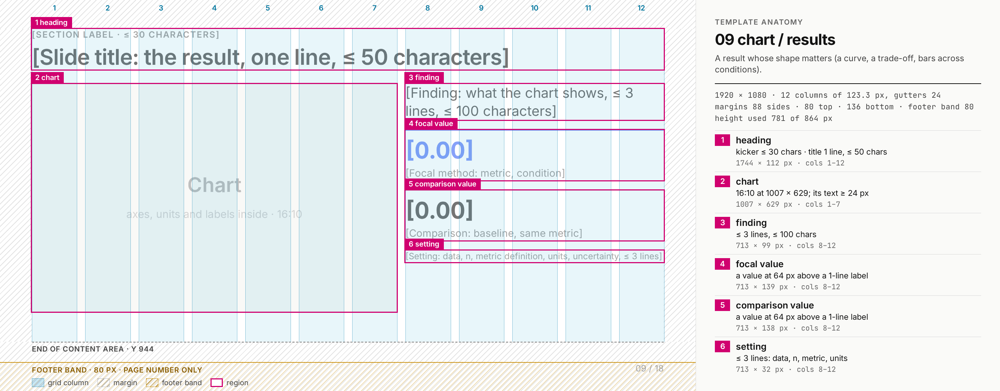

Clean render: `templates/09-chart.png`

- **Use for:** a result whose shape matters: a curve, a trade-off, bars across conditions.
- **Not for:** values that must be read exactly (10), or one number that carries the slide (13).
- **Grid:** chart in cols 1–7 (16:10 at 1007 × 629), reading in cols 8–12. Use 8 + 4 for a wide
  chart with a short reading.
- **Capacity:**
  - finding ≤ 3 lines (≤ 100 characters);
  - two called-out values at 64 px, each above a one-line label (≤ 40);
  - setting ≤ 3 lines.
- **Rules that bind it:**
  - the chart is drawn with `charts.py` at 1007 × 629, with axes, units and labels at 24 px or more;
  - its numbers come from the same data file as any table;
  - blue marks the focal method, red below target, green meets target;
  - no legend when direct labels fit.
  The called-out values sit above their labels, as R7 asks of large numbers.
- **Do:** state the finding the chart shows in the title.
  **Don't:** call out a value the chart does not show.

## 10 table

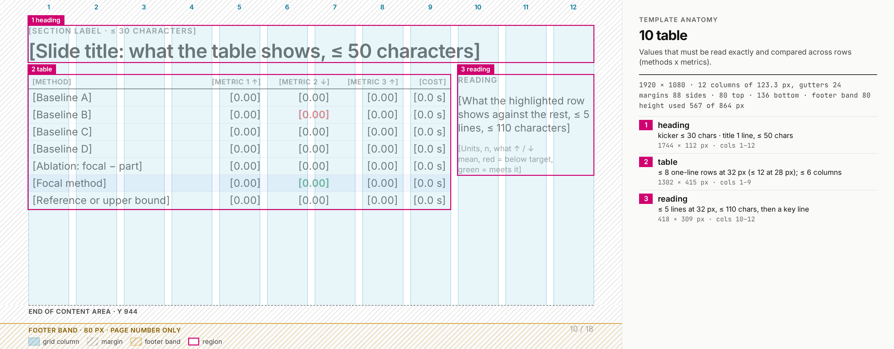

Clean render: `templates/10-table.png`

- **Use for:** values that must be read exactly and compared across rows (methods × metrics).
- **Not for:** a trend or a trade-off (09).
- **Grid:** table in cols 1–9, reading guide in cols 10–12. A table with more than five numeric
  columns takes `.c12` and moves the reading into the title.
- **Capacity:**
  - with `table.lg` (32 px), ≤ 8 one-line body rows; with the default 28 px table, ≤ 12;
  - ≤ 6 columns in `.c9`, about 215 px each;
  - reading ≤ 5 lines at 32 px (≤ 110 characters).
- **Rules that bind it:**
  - numbers right-aligned in `.n` columns, with one precision per column; a text column right
    after a `.n` column starts 40 px after the numbers (the theme pads it), so "1" and "act" do
    not read as "1 act";
  - one `tr.focus` row for the focal method;
  - `td.bad` for below target, `td.good` for meeting it, `td.amber` for a caveat (provisional,
    small n, not comparable);
  - for a whole row, `tr.bad` or `tr.amber` with `td.lab` on its label cell: only the label turns
    red or amber, so the numbers stay ink;
  - headers are set in capitals: a unit or variable whose case matters goes in
    `` (`<th class="n">reply (s)</th>`);
  - the caption or the key line names the population and n.
- **Do:** trim the columns the slide's claim does not need, and move n to the notes when it is
  constant.
  **Don't:** let a long label overflow its cell: a cell wider than its column collides with its
  neighbour (`deck.py selftest`, the table-cell fixture).

## 11 image comparison

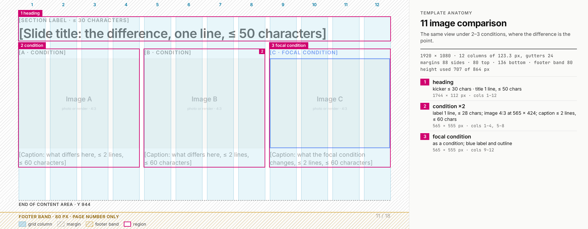

Clean render: `templates/11-image-compare.png`

- **Use for:** the same view under two or three conditions, where the difference is the point.
- **Not for:** two different views of one scene (05).
- **Grid:** three `.c4` columns with 4:3 images of 565 × 424, a label above and a caption below each.
  Two images take two `.c6` columns at 16:9 (860 × 484).
- **Capacity:**
  - label 1 line (≤ 28 characters): a wrapped label pushes its image off the shared top edge;
  - caption ≤ 2 lines at 28 px (≤ 60).
- **Rules that bind it:** identical sizes and crops; one restrained marker on the focal image only
  (a 4 px blue outline inside the image and a blue label).
- **Do:** say in each caption what differs in that image.
  **Don't:** put a text label on top of an image without `data-layer="overlay"`; unmarked, it is a
  collision.

## 12 text-dominant

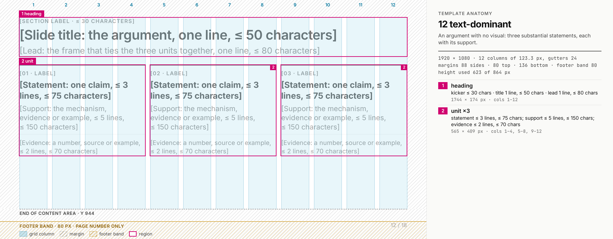

Clean render: `templates/12-text-dominant.png`

- **Use for:** an argument with no visual: three substantial statements, each with its support.
- **Not for:** a list of fragments; if the points are short, they belong on 03.
- **Grid:** three `.c4` units on 2 px rules (two units take `.c6` each), with the evidence line
  pinned to each unit's bottom so the three align.
- **Capacity:**
  - lead 1 line (≤ 80 characters);
  - per unit: a label, a statement ≤ 3 lines at 38 px (≤ 75), support ≤ 5 lines at 32 px (≤ 150),
    and evidence ≤ 2 lines at 28 px (≤ 70).
- **Rules that bind it:** accent only the one key term per unit that carries a fixed colour
  meaning; never a paragraph wider than a unit.
- **Do:** give each unit a number, source or example in its evidence line.
  **Don't:** fill the three units with three restatements of one claim.

## 13 key number

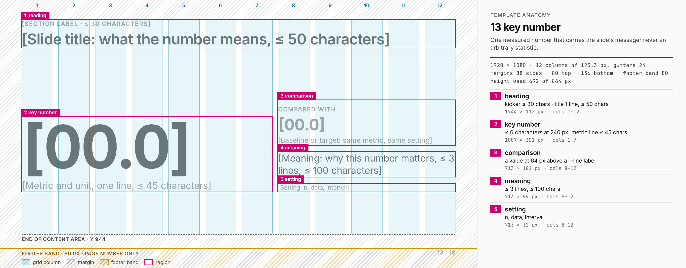

Clean render: `templates/13-key-number.png`

- **Use for:** one measured number that carries the slide's message; once or twice per deck.
- **Not for:** an arbitrary statistic, or two numbers that make one claim (see the two-metric
  example in `template-authoring.md`).
- **Grid:** the number and its metric line in cols 1–7; comparison, meaning and setting in
  cols 8–12, centred vertically under the title.
- **Capacity:**
  - number ≤ 6 characters at 240 px, with the unit in the metric line;
  - metric line 1 line (≤ 45 characters);
  - meaning ≤ 3 lines (≤ 100).
- **Rules that bind it:** R7 applies directly, because the number sits beside text. It is allowed
  here only because `.c7` gives explicit width with slack. Measured: "100.0%" at 240 px is 885 px
  wide in the 1007 px column (122 px to spare), while "25.6%" at 240 px is 737 px and would
  overflow a `.c5` (713 px). The number is ink unless a colour meaning applies; the setting line
  gives n or the interval. The comparison value is grey (`.num sec`) when it is a plain baseline;
  when it also carries a meaning, such as falling below target, it takes that colour (`.num red`)
  and the label or meaning line says so in words.
- **Do:** keep the number in `.c7`, or set it smaller with a measured width. The example deck sets
  its key numbers at 160 px in `.c5` for this reason.
  **Don't:** move a 240 px number into a narrower column beside text.

## 14 comparison

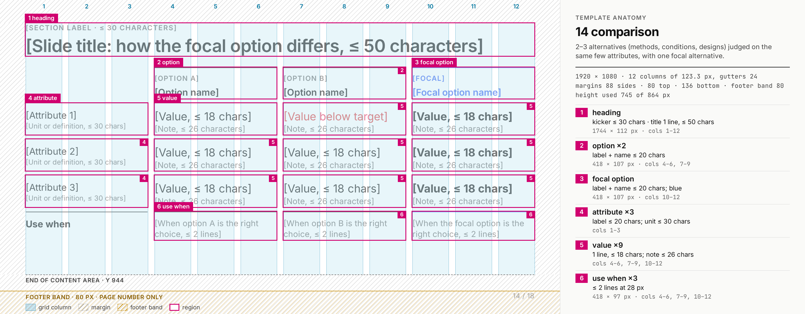

Clean render: `templates/14-comparison.png`

- **Use for:** two or three alternatives judged on the same few attributes, with one focal
  alternative.
- **Not for:** more than three alternatives or more than three attributes (10).
- **Grid:** `.grid12` rows. The attribute column and each alternative span 3 columns (`.span4` each
  for two alternatives). The focal alternative sits last, on a blue rule, with a blue name and
  semibold values.
- **Capacity:**
  - ≤ 3 attribute rows plus a "use when" row;
  - name ≤ 20 characters;
  - value 1 line at 38 px (≤ 18) with a note of 1 line at 28 px (≤ 26);
  - attribute label ≤ 20 with a unit line ≤ 30.
- **Rules that bind it:** the attribute is the row; red marks a value below target, never "the
  other method".
- **Do:** compare on the attributes the decision depends on, in the same units.
  **Don't:** colour a whole column red because it is not the focal option.

## 15 statement / quote

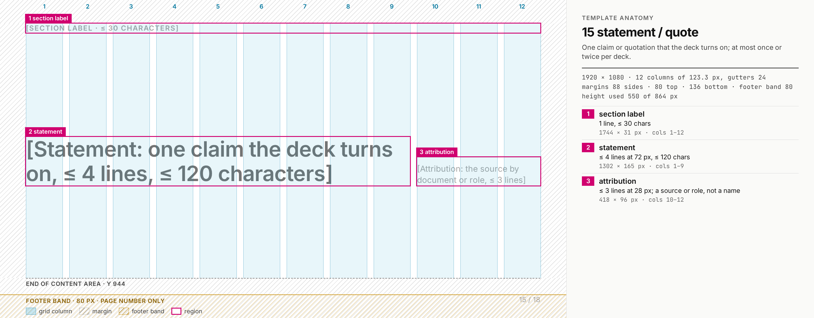

Clean render: `templates/15-statement.png`

- **Use for:** one claim or quotation that the deck turns on; at most once or twice per deck.
- **Not for:** a slogan, or a transition between sections (02).
- **Grid:** statement in cols 1–9, attribution in cols 10–12 on a rule, bottom-aligned and centred
  vertically.
- **Capacity:**
  - statement ≤ 4 lines at 72 px (≤ 120 characters);
  - attribution ≤ 3 lines at 28 px.
- **Rules that bind it:** attribute by source (a paper, a review, a requirement, a role), not a
  person's name unless asked; no quotation-mark ornaments.
- **Do:** quote verbatim and name the document in the attribution and the notes.
  **Don't:** paraphrase inside quotation marks.

## 16 summary / closing

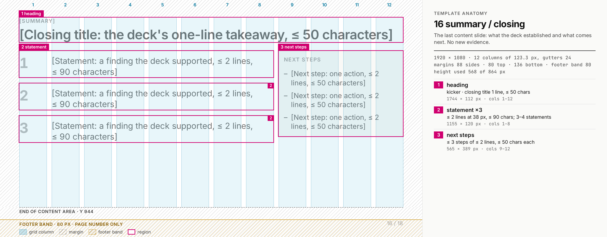

Clean render: `templates/16-summary.png`

- **Use for:** the last content slide: what the deck established and what comes next.
- **Not for:** new evidence, or a "thank you" slide.
- **Grid:** numbered statements in cols 1–8 (number in `.c1`, text in `.c7`), next-steps panel in
  cols 9–12. The title is the final, largest statement.
- **Capacity:**
  - title 1 line (≤ 50 characters);
  - 3–4 statements of ≤ 2 lines at 38 px (≤ 90);
  - ≤ 3 next steps of ≤ 2 lines at 32 px (≤ 50).
- **Rules that bind it:** statements restate findings already shown, in the order shown; next steps
  are actions, without names or dates unless asked.
- **Do:** let each statement point back to one finding slide (say which in the notes).
  **Don't:** introduce a number here that no earlier slide showed.

## 17 paper idea

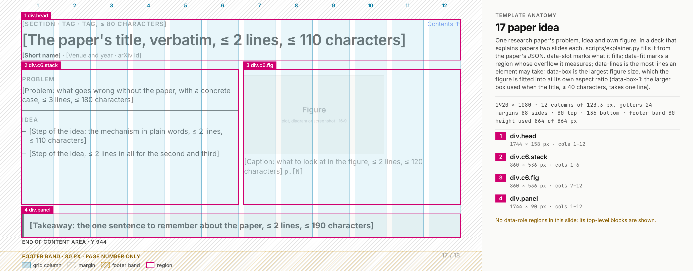

Clean render: `templates/17-paper-idea.png`

- **Use for:** slide 1 of a paper explainer: one paper's problem, idea and its own figure.
  `scripts/explainer.py` fills it from the paper's JSON (`paper-explainer.md`); it is not filled by
  hand.
- **Not for:** the deck's own findings (03, 04).
- **Grid:** text (Problem, Idea) in cols 1–6 and the figure in cols 7–12, both on 2 px rules, then a
  takeaway bar across all 12 columns.
- **Capacity:** in the template's comment, which `explainer.py` enforces per paper: it reports a
  region that overflows, in pixels, lines and characters to cut.
- **Rules that bind it:** the paper's title verbatim; its own figure, cropped from the cited page,
  with that page; no authors, keys or dates beyond the venue year on the face; blue only for
  links.
- **Regions:** the template marks its slots with `data-slot` for `explainer.py`, not `data-role`,
  so the anatomy outlines its top-level blocks.
- **Do:** crop the paper's own figure and cite its page.
  **Don't:** redraw the figure, or put the authors on the face.

## 18 paper method

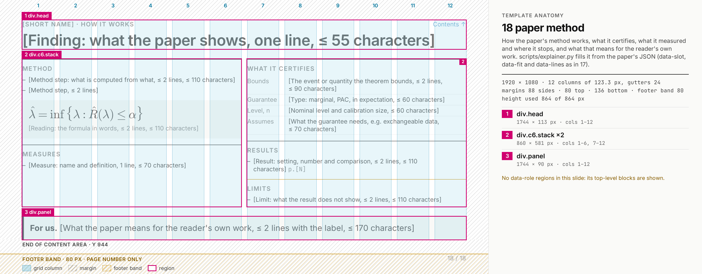

Clean render: `templates/18-paper-method.png`

- **Use for:** slide 2 of a paper explainer: how the method works, what it certifies, what it
  measured, where it stops, and what that means for the reader's own work.
- **Not for:** a method of the deck's own (07, 08).
- **Grid:** Method, formula panel and Measures in cols 1–6; What it certifies, Results and Limits in
  cols 7–12, on 2 px rules (Limits on the amber rule); then a bar across all 12 columns that starts
  with its label ("For us." by default).
- **Capacity:** in the template's comment, enforced per paper by `explainer.py`, as for 17.
- **Rules that bind it:**
  - every result carries its page, and its verbatim quote, checked against the paper, sits in the
    notes;
  - "What it certifies" states the theorem's event, guarantee type and level, never a measured
    rate;
  - nothing red or green.
- **Regions:** as 17, top-level blocks.
- **Do:** give every result its page.
  **Don't:** put a measured rate in "What it certifies".
