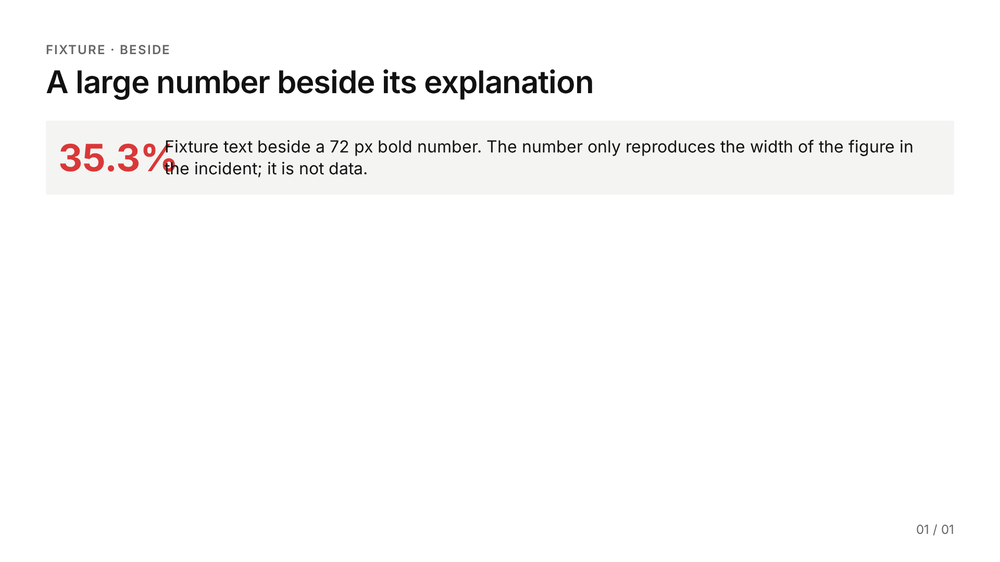
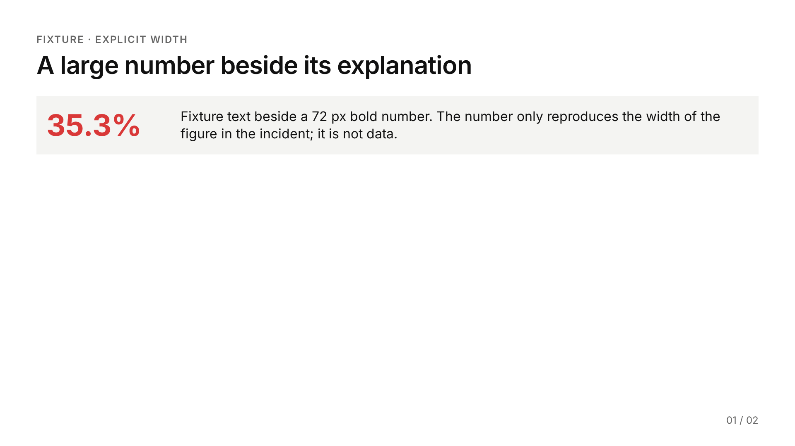
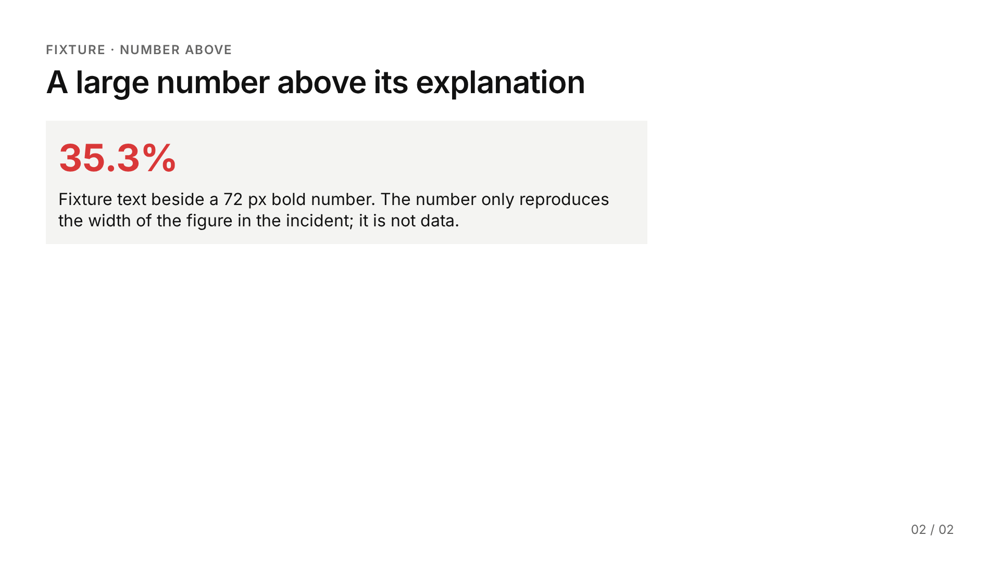
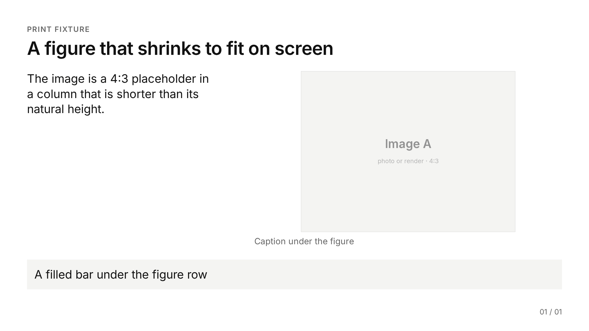
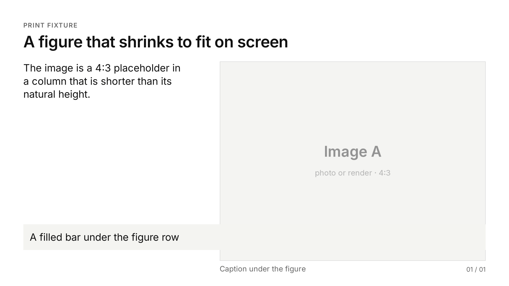
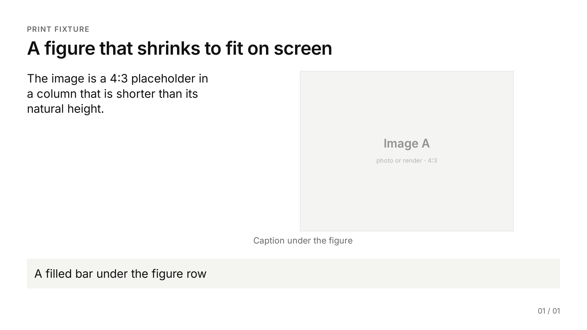

# Verification

The full check pipeline a deck passes before it is handed over, in order. Each step names what it
catches and what it cannot catch, so no step is mistaken for another. The rules being checked are
in `slide-rules.md`.

`<skill>` below is this skill's folder; `<deck>` is the deck folder (`deck.json`, `slides/`,
`assets/`).

## The pipeline

The steps run in the order of `SKILL.md` §3, steps 6 to 12. The content ledger (`SKILL.md` step 2)
comes before them, written before any slide: step 6 checks the slides against the sources it names.

| # | step | how | catches | cannot catch |
|---|---|---|---|---|
| 1 | Writing passes | `python3 <skill>/scripts/deck.py text <deck> --prose` prints each slide's face text, as written, and its notes; run **unslop**, **presend**, **simply-explain** on it (`slide-rules.md` §9) | filler, AI patterns, unbacked universals, contradictions between slides, unexplained jargon | layout |
| 2 | Rules pass | read every slide face against `slide-rules.md` §1–5 in `deck.py text <deck>` (capitals as the audience sees them); the face scan below | names, dates, ids, paths, codenames, footer labels, titles that are not findings, unlabelled illustrative numbers | overlap, overflow |
| 3 | Screen check | `python3 <skill>/scripts/deck.py check <deck>` | overflow, clipped text, text past its box, every pair of colliding objects (R7), content in the footer band, missing images, type under 24 px, one-word last lines, fonts that failed to load; it also warns about an image in `assets/` that no slide uses | how the slide looks; an expression broken across lines (`86–` / `91%`); print-only layout changes |
| 4 | Print check | `deck.py pdf <deck>`: freezes every image and SVG at its screen size, prints, then runs `pdfcheck.py` on the PDF | text over text, text over images, text or images running into a filled panel's edge, content in the footer band, wrong page count or size, as Chromium actually printed it | formulas, hairline rules and connector arrows: a typeset formula prints as vector paths, so pdfcheck counts it neither as text nor as an image ("0 images" on a deck whose only graphics are formulas), and vector drawings other than filled rectangles are not read; step 3 covers them on screen, and freezing keeps the printed formula at its checked size |
| 5 | Look at every slide and page | `deck.py png <deck>`, then `python3 <skill>/scripts/contact_sheet.py <deck>` (each tile labelled with its slide id and first heading); then open every single PNG, and the PDF pages | misalignment, cramped or orphaned text, unbalanced columns, a chart whose own labels collide, wrong emphasis, symbols capitalised in a kicker, a page that printed differently | numbers |
| 6 | Number trace | `python3 <skill>/scripts/numtrace.py <deck> <source files>`, which looks up every number on the faces and in the notes in the sources | numbers with no source, numbers copied wrong, double rounding | a number taken from the wrong row of the right source; missing n or unit; anything about layout |
| 7 | Exports | `deck.py pptx <deck>`; `deck.py inline <deck>` when the deck goes to claude.ai Slides (it compares every inlined slide with the build pixel by pixel) | a broken export | — |
| 8 | Report | tell the user what was verified and what was not: slides not looked at, numbers not traced, exports not produced | — | — |

`deck.py all <deck>` runs steps 3 and 4 and the PPTX export in one command, and exits 1 if the
screen or print check found a problem. It does not replace steps 1, 2, 5, 6 and 8. After any fix
to a slide, run steps 3 to 6 again.

### Step 1: the writing passes

Run them on the output of `deck.py text <deck> --prose`, faces and notes. It prints the text as
written, not in the capitals a kicker or table header shows, so a checker does not take "HOW TO
READ" for three undefined acronyms. It puts a blank line after every block, so a kicker, a title
and a caption without full stops are not joined into one long sentence, and it prints its headers
as Markdown headings, which a Markdown-aware checker skips (simply-explain's does). On a 10-slide
test deck, simply-explain's checker reported 39 findings on the plain `text` output, 30 of them
kicker words read as acronyms; on the `--prose` output it reported one, a 36-word sentence in the
notes.

Two kinds of line that `slide-rules.md` requires can draw unslop flags, and stay: the summary
statements, which restate findings already shown (§4), and a section slide's contents line, which
lists the part's slide topics. Cut what the flag names anywhere else.

### Step 2: the face scan

`python3 <skill>/scripts/deck.py text <deck>` prints each face as the audience sees it, capitals
included: read it for person names, internal ids and codenames. Years and file paths are easy to
miss by eye. This scan prints any four-digit year (1900–2099), file name with a data or code
extension, or path with two slashes that sits on a slide face. It ignores speaker notes, HTML
comments and tag attributes:

```
python3 -c "import re,sys,glob; [print(f, m.group(0)) for f in sorted(glob.glob(sys.argv[1]+'/slides/*.html')) for m in re.finditer(r'\b(19|20)\d\d\b|[\w.-]+\.(md|py|json|csv|ya?ml|ipynb)\b|\w*/[\w.-]+/[\w./-]*', re.sub(r'(?s)<aside.*?</aside>|<!--.*?-->|<[^>]*>', ' ', open(f).read()))]" <deck>
```

It prints nothing for `references/example-scenarios`. A year that is data, such as a dataset's
name, may stay. Person names, internal ids and codenames have no reliable pattern, so read the faces
for them.

### Step 3: reading the report

`deck.py check` prints one row per slide: the lowest in-flow edge, the number of objects measured,
and the count of problems. Then it prints one line per problem:

| kind | means | fix |
|---|---|---|
| `area` | a box leaves the content area | cut words, split the slide |
| `canvas` | a box leaves the 1920 × 1080 slide | the same |
| `text` | text runs past its own box, or a box's content overflows it | widen the column on the grid, or cut words |
| `collision` | two objects overlap by more than 2 px | re-layout: give the wider object a wider column, or stack the two |
| `footer` | something other than the footer reaches into the footer band (y 1000 and below) | move it into the content area, which ends at y 944 |
| `image` | an image failed to load | fix the path under `assets/` |
| `font` | text under 24 px (table headers excepted) | use the type scale; never shrink to fit |
| `widow` | a block of two or more lines ends on a line holding one word | cut or reword, or bind the last two words with `&nbsp;`; the theme's `text-wrap: pretty` already avoids most |

After the problems it may print warnings, which do not change the exit code:

```
  warning: assets/photo.png is not referenced by any slide (build/ still copies it)
```

An image, video, sound or PDF in `assets/` that no slide face uses is copied into `build/` and
shipped with the deck anyway: delete it, or use it. A reference inside an HTML comment or in the
speaker notes does not count as a use.

Text is measured on its rendered lines. Images, SVG (formulas included), filled boxes, border rules
and pseudo-element shapes such as connector arrows count as objects too. A filled or ruled box never
collides with its own contents. Elements under `data-layer="overlay"` (a label set on an image on
purpose) may overlap base content, but not each other.

Never fix a problem by lowering the type scale: cut words, re-layout on the grid, or split the slide.

### Step 5: looking

Look at every slide, not a sample, and then at every page of the PDF, for:

- elements whose edges are off the grid;
- spacing outside the 12 / 20 / 28 / 40 px steps;
- an expression broken across lines (`86–` / `91%`, `0.476 →` / `0.719`, `per-` / `count`), or a
  line that starts with a separator (`· 20 random splits`): bind it (`technical-swiss.md`,
  typesetting traps); the `widow` check catches only a lone last word;
- raw TeX left as text (`s_i`, `\alpha`) and a formula smaller than the text beside it: a `.math`
  inside `.mono` renders at 0.9 em, and the default `cm` letters stand about 18% shorter than
  Inter's lower case (`technical-swiss.md`, Math, has the measures and the `dejavusans` fix);
- a symbol or unit capitalised by a kicker or table header (`N = 18` for `n = 18`, `MS` for `ms`):
  wrap it in `<span class="nocase">`;
- a column much fuller than its neighbour;
- an accent colour used without its meaning;
- a chart with colliding labels inside the image (the screen check sees a chart as one image).

To see a slide's grid, run `python3 <skill>/scripts/anatomy.py --deck <deck>`. It draws the 12
columns, the margins and the footer band over each slide in `build/anatomy/`, and lists each
region's columns.

An agent that cannot open a PDF renders its pages to PNG and looks at those (`SKILL.md` step 9 has
the one-line command).

### Step 6: the number trace

- Build the ledger before any slide exists (`SKILL.md` step 2 gives its file and columns).
- Put each number's source in the slide's notes.
- Run the trace against the files the numbers come from: CSV, JSON, Markdown, logs, saved command
  output, or a paper's page-marked text (`quotecheck.py text <pdf> --out f.txt` writes one). Never
  pass the ledger itself: it holds copies of the slide numbers, so every number would trace to it.

  ```
  python3 <skill>/scripts/numtrace.py <deck> results.json report.md --allow 0-10
  ```

  It renders the deck in Chrome (the same text as `deck.py text`) and checks every number on the
  faces and in the notes (`--faces-only` skips the notes). A number traces when a source holds the
  same value, a value with more decimals that rounds to it, or, for a percentage, the fraction
  100 times smaller (`0.353` for `35.3%`). `--exact` turns off the rounding. Ids and versions such
  as `G13`, `v1.2` or `p.14` are not read as numbers.
- A derived number (a sum, a difference, a ratio, `n + 1`) has no source file until its arithmetic
  is saved. Run the computation, save the command with its printed output as a text file next to
  the ledger, and pass that file as a source too; the notes name the inputs and the arithmetic. For
  `k = ceil((n + 1)(1 − α))` at n = 18 and α = 0.10, a saved line `n + 1 = 19; 19 * 0.90 = 17.1;
  ceil(17.1) = 18` traces 19, 0.90 and 17.1. Its status is that of its inputs: computed from
  measured numbers, it is stated flat.
- `--allow` lists numbers that need no source: ordinals, part and slide numbers, counts the slide
  defines itself (`--allow 0-10,100`). It takes single values and integer ranges: `0-10` allows the
  integers 0 to 10, not 0.5 or 0.859; give a decimal as a single value, and only when it truly needs
  no source. Each untraced number prints with its slide, face or notes, and its line; `--verbose` also lists where each traced number was found. Exit 0 means every number
  traced or was allowed, 1 that some did not, 2 a usage, source or build error.
- A trace proves only that the value occurs in a source, not that it came from the right row, so
  read each untraced number and each table against its source. Text drawn inside images is not
  read, so check chart labels against the chart's data by eye.

## Worked failure 1: the R7 incident

The incident: a 72 px bold "35.3%" and its explanatory text sat side by side in one row and
collided. The deck had passed a structure lint, a number trace, a contrast check and a height
estimate. None of those looks at overlap, and the deck had not been rendered. `deck.py selftest`
rebuilds the slide as a fixture: the number in a 180 px grid column beside its text.



`deck.py check` on it:

```
  slide 01 [text] p.red "35.3%": content 230x94 overflows its 180x94 box
  slide 01 [collision] p.red "35.3%" (text): overlaps p.s "Fixture text beside a 72 px bold number. The ..." (text) by 26 x 39 px at (316, 262)
  warning: assets/photo.png is not referenced by any slide (build/ still copies it)

2 problem(s); 1 of 1 slide(s) affected
```

Why a height estimate missed it: the row is 94 px tall and well inside the content area. The fault
is horizontal. The number's content is 230 px wide (Chrome's scroll width, which the check reports;
the glyph run itself measures 228 px) and its column gives it 180, so the text beside it starts
under the number's last glyphs.

The two fixes R7 names, both clean under `deck.py check` ("all 2 slides fit; no collisions"):

| explicit width with slack: the column widened to 300 px | the number above its text |
|---|---|
|  |  |

Size the slack from a measurement, not a character estimate. Measured in this theme's Inter at the
theme's sizes:

| text | size | width |
|---|---|---|
| 35.3% | 72 px bold | 228 px (glyph run) |
| 25.6% | 240 px (`.big`) | 737 px |
| 100.0% | 240 px (`.big`) | 885 px |
| 0.81 | 240 px (`.big`) | 501 px |
| 100.0% | 64 px (`.num`) | 244 px |

Column widths: `.c3` 418, `.c5` 713, `.c6` 860, `.c7` 1007 px. So "25.6%" at 240 px overflows a
`.c5` column, and "100.0%" fits `.c7` with 122 px to spare. The same fault at template scale is
the first draft of the worked example in `template-authoring.md`.

## Worked failure 2: the print lesson

Chromium's printed PDF can lay out differently from the screen. The fixture (`deck.py selftest`,
deck `print-shrink`) has a 4:3 image with `flex: 1 1 auto; min-height: 0` in a flex column inside a
grid row that is shorter than the image's natural height. On screen the image shrinks to fit, and
`deck.py check` passes:



Printed as is (`deck.py pdf <deck> --no-freeze`), the image takes its natural size, 1003 × 753 px.
It runs across the filled bar below it and pushes the caption into the footer band. pdfcheck reads
the PDF and reports both:



```
page 1: [panel] image #1 (1003 x 753 px) runs across the edge of the filled panel (88, 847) to (1832, 944) by 1003 x 97 px at (829, 847)
page 1: [footer] "Caption under the figure" reaches y 1031; the footer band starts at y 1000
PDF FAIL: 2 finding(s) on 1 of 1 pages
```

`deck.py pdf <deck>` (the default) first measures the screen layout. It then fixes every image and
SVG at its measured width and height (`flex: none`, min and max sizes cleared) and prints. The PDF
matches the screen and passes:



```
PDF OK: 1 pages, 16:9; 8 text lines, 1 images and 1 filled panels checked: no overlaps, nothing in the footer band
```

Two habits follow from this case:

- print with `deck.py pdf` (never the browser's print dialog);
- look at the PDF pages themselves before sending a PDF.

## When rendering is not possible

If no Chrome or Chromium can run:

- compute every element's box from the layout (column widths from `technical-swiss.md`, line
  heights from the type scale);
- test each pair of boxes for overlap;
- tell the user which slides were not checked visually.

A height estimate alone does not satisfy R7. `deck.py check` needs only Chrome and the Python
standard library (plus matplotlib when the deck has math). `scripts/setup.sh` installs a headless
Chromium when none is present.

## Proving the checks can fail

`python3 <skill>/scripts/deck.py selftest <empty-dir>` builds fixture decks and runs `check` and
`pdf` on them. The fixtures cover:

- the R7 incident and its two fixes;
- one slide per object kind: text on an image, an overlay label, two overlays, a rule through text,
  a connector under text, the footer band, a table cell, a formula, a panel, a clean slide, and a
  paragraph that ends on one word;
- the print fixture;
- the unused-asset warning: it appears for a deck whose `assets/` holds an image no slide uses, and
  the exit code stays as the problems set it.

It prints PASS for each expected verdict and ends with "selftest passed: 7 of 7 as expected". Run
it after changing `deck.py`, `pdfcheck.py` or the theme.

## How the case images were made

```
python3 <skill>/scripts/deck.py selftest st
python3 <skill>/scripts/deck.py png st/r7-incident        # -> r7-incident.png
python3 <skill>/scripts/deck.py png st/r7-fixed           # slides 1, 2 -> r7-fix-explicit-width.png, r7-fix-number-above.png
python3 <skill>/scripts/deck.py png st/print-shrink       # -> print-screen.png
cp -r st/print-shrink st/unfrozen && python3 <skill>/scripts/deck.py pdf st/unfrozen --no-freeze
python3 <skill>/scripts/deck.py pdf st/print-shrink
python3 -c "import pymupdf,sys; p=pymupdf.open(sys.argv[1])[0]; p.get_pixmap(matrix=pymupdf.Matrix(1920/p.rect.width,1080/p.rect.height)).save(sys.argv[2])" st/unfrozen/build/print-shrink.pdf print-pdf-unfrozen.png
```

The frozen page comes from `st/print-shrink/build/print-shrink.pdf` the same way. The PNGs are
stored with a 256-colour palette.
